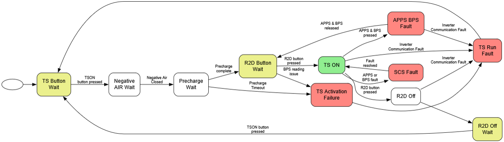

# Code overview

All C sources + header files are inside `src/`. `.c` files are always inside `Src/` and `.h` files are always inside `Inc/`. Almost all of our code is inside `src/SUFST/`, with the exception of some user code blocks for initialisation in `src/Core/`, notably `main.c` and `freertos.c`. Everything else is generated by STM32CubeMX based on the IOC in `src/VCU.ioc`.

## Services vs Interfaces vs Functions

The most interesting files in this codebase are:

- `src/SUFST/Src/vcu.c`: Initialisation code for all services
- `src/SUFST/Src/config.c`: Config values used everywhere (lots of calibration, this could get moved into an EEPROM in the future to avoid having to commit this to git)
- `src/SUFST/Src/Services/tick.c`: Main lifecycle state machine

## SUFST Middlewares

This project depends on two submodules:

- [can-defs](https://github.com/sufst/can-defs) - CAN dbc definitions, with generated [cantools](https://github.com/cantools/cantools) C source helpers
- [rtcan](https://github.com/sufst/rtcan) - RTOS service for managing concurrent access to CAN peripherals (built with its FreeRTOS / CMSIS-RTOS2 OSAL backend, `rtcan_osal_freertos.c`)

Both of these are located in `src/SUFST/Middlewares` and added as git submodules.

## RTOS (FreeRTOS)

The VCU runs on FreeRTOS (kernel V11.2.0, from ST's `stm32_mw_freertos` package in
`src/Middlewares/Third_Party/FreeRTOS`). The kernel configuration is in
`src/Core/Inc/FreeRTOSConfig.h`.

Start-up (`main.c` -> `freertos.c`):

1. `osKernelInitialize()`
2. `MX_FREERTOS_Init()` creates the "VCU init" task at the highest priority.
3. `osKernelStart()` starts the scheduler. The init task runs first and calls `vcu_init()`, which
   creates every service's tasks, queues and mutexes, then deletes itself. The services all have a
   lower priority, so none of them runs until initialisation is complete. (It runs in a task
   because before the scheduler starts FreeRTOS keeps interrupts masked, which would stop the HAL
   tick and break HAL timeouts during initialisation.)

The SUFST services use the native FreeRTOS API. CMSIS-RTOS2 (`cmsis_os2.c`) is only included
because the RTCAN FreeRTOS OSAL is written against it.

| Task                 | Priority | Stack (bytes) | Runs                               |
| -------------------- | -------- | ------------- | ---------------------------------- |
| VCU init             | 55       | 2048          | once at boot (`vcu_init()`), exits |
| Timer service        | 55       | 1024          | software timers (TS on LED blink)  |
| Control              | 38       | 2048          | every 10 ms (state machine)        |
| RTCAN Tx/Rx (CAN-T)  | 38       | 1024          | on CAN traffic                     |
| PM100                | 37       | 2048          | on inverter broadcasts             |
| TICK                 | 37       | 2048          | every 10 ms (APPS/BPS/ADC inputs)  |
| REMOTE               | 37       | 2048          | every 10 ms                        |
| RTCAN Tx/Rx (CAN-S)  | 37       | 1024          | on CAN traffic                     |
| Dash                 | 36       | 2048          | once at boot (visual check), exits |
| CANBC                | 36       | 2048          | every 100 ms                       |
| WHEELSPEED           | 36       | 2048          | every 20 ms                        |
| FANS                 | 28       | 2048          | on dash broadcasts                 |
| LOG                  | 25       | 2048          | when a message is queued           |
| HEARTBEAT            | 24       | 2048          | every 250 ms (+ RAM report)        |
| SD                   | 24       | 8192          | when a WARN/ERROR line is logged   |
| IDLE                 | 0        | 1024          | when nothing else runs             |
| USB_MSC              | 24       | 2048          | once, only in USB mass storage mode |

Things to keep in mind:

- **Priorities**: a higher number is a higher priority (the opposite of ThreadX). Time slicing is
  off, so tasks of equal priority only switch when one blocks.
- **Ticks**: 1 tick = 1 ms (`configTICK_RATE_HZ = 1000`). Use `SECONDS_TO_TICKS()` in `config.c`.
- **Interrupts**: only interrupts with an NVIC priority of 5 or numerically higher (i.e. lower
  urgency) may call FreeRTOS `...FromISR()` functions (`configMAX_SYSCALL_INTERRUPT_PRIORITY`).
  CAN (5), EXTI (6), SDMMC/SD DMA (7) and USB (15) are fine. `log_printf()` can be called from
  such interrupts.
- **Mutexes** are not recursive: a task must not take a mutex it already holds, and must only give
  back a mutex it took.
- **Task functions must never return**: call `vTaskDelete(NULL)` to end a task.
- **Memory**: task stacks come from the FreeRTOS heap (`heap_4.c`, `configTOTAL_HEAP_SIZE`); all
  other RTOS objects are statically allocated inside the service contexts. Stack overflow
  checking is enabled and halts in `Error_Handler()`. After changing a stack size or adding a
  task, run `tests/run_tests.sh`: it includes a worst-case stack analysis of every task (see
  [how-to-run.md](how-to-run.md#step-1b-check-the-ram-budget)).
- **Don't block the control task**: it runs every 10 ms and must never wait for long (e.g. no
  `vTaskDelay()` in a state handler); time things by comparing `xTaskGetTickCount()` instead.
  It also kicks the independent watchdog every cycle: if it stops for more than ~0.34 s
  (worst case), the watchdog restarts the VCU (see `Interfaces/watchdog.c`).

## SD card and USB mass storage

- `src/SUFST/Src/Interfaces/sd_card.c`: SD card block device (SDMMC1 + DMA).
- SD logging (`sd_logging.c`) uses FatFs (`src/Middlewares/Third_Party/FatFs`, configured in
  `src/FATFS/Target/ffconf.h`, disk driver `sd_diskio.c`). Logs are written to `log_N.txt`.
- Holding the USER button at power-on enters USB mass storage mode, which exposes the SD card
  to a PC using the ST USB Device library (`src/USB_DEVICE`). Power cycle to exit.

## STM32CubeMX generation

> **Note:** `VCU.ioc` enables FREERTOS (CMSIS_V2) with no tasks or other RTOS objects: all of
> them are created by the SUFST services from `vcu_init()`. FatFs and the USB device stack are
> **not** enabled as CubeMX middleware on purpose (SDMMC1 and USB_OTG_FS are plain peripherals
> with "do not generate function call" set), because they are a newer FatFs (R0.16) and our own
> `sd_diskio.c` / `usbd_conf.c` code that the generator would overwrite. Keep it that way.
> Settings in `FreeRTOSConfig.h` that CubeMX does not manage are in its `USER CODE BEGIN Defines`
> section. After regenerating, check that `git diff` only shows what you changed, and that the
> generator did not add a `defaultTask` or replace `src/Middlewares/Third_Party/FreeRTOS` with an
> older kernel (the code needs FreeRTOS V11, e.g. for `xTaskDelayUntil`).

When you run the generator, make sure you first open the correct ioc, run the generator. If you're making any changes to included components, there's a chance you'll have to manually update the root `Makefile`. You can refer to the generated one in `src/Makefile` to see what to add, although don't just copy it over since this misses out some of our code (e.g. our middlewares).

## ctrl.c state machine

The main states of the VCU are defined in `ctrl.h`. These are:

```c
typedef enum
{
    CTRL_STATE_TS_BUTTON_WAIT,
    CTRL_STATE_WAIT_NEG_AIR,
    CTRL_STATE_PRECHARGE_WAIT,
    CTRL_STATE_R2D_WAIT,
    CTRL_STATE_TS_ON,
    CTRL_STATE_R2D_OFF,
    CTRL_STATE_R2D_OFF_WAIT,
    CTRL_STATE_TS_ACTIVATION_FAILURE,
    CTRL_STATE_TS_RUN_FAULT,
    CTRL_STATE_SPIN,
    CTRL_STATE_APPS_SCS_FAULT,
    CTRL_STATE_APPS_BPS_FAULT,
} ctrl_state_t;
```

You can read `ctrl.c` to see what happens in each of these states. Below is a rough diagram (although things have slightly changed since the diagram was created, refer to the code directly for an accurate view).


